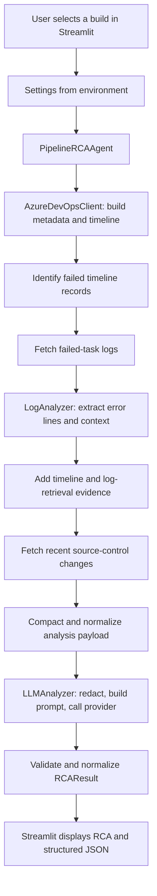

# Project Overview

## Purpose

This application investigates a failed Azure DevOps pipeline build and presents an evidence-based root-cause analysis (RCA). It can analyze a build by ID, by build number, or select the latest failed build in the configured project. The current user interface is a Streamlit application; analysis is run on demand and is not automatically triggered by a pipeline event.

## End-to-End Flow



### What happens at each step

1. The user enters a build ID or build number, or leaves the field blank to analyze the latest failed build.
2. `PipelineRCAAgent` retrieves the build metadata and timeline from Azure DevOps.
3. The agent identifies failed timeline records, preserving timeline order so the earliest failed record is the primary RCA candidate. It does not treat skipped downstream records as the root failure.
4. Logs are fetched for failed records that have log IDs. `LogAnalyzer` extracts error-focused windows with surrounding lines. If a log is missing or cannot be retrieved, the agent still includes available timeline details and log-retrieval status.
5. Recent build changes are fetched as supporting context. They are not treated as proof of causation.
6. The payload is compacted and passed to the configured LLM provider. The model is asked to return a structured RCA with a summary, cause, category, failed task, confidence, evidence, and suggested fixes.
7. The LLM response is checked for valid JSON and expected fields, then validated into `RCAResult`. Compiler diagnostics also receive deterministic handling so unsupported model speculation does not override explicit compiler evidence.
8. Streamlit displays the analysis and its structured representation.

## Main Components

| Component | Responsibility |
| --- | --- |
| `streamlit_app.py` | User interface, build selection, configuration summary, and result display. The agent is cached as a Streamlit resource. |
| `config.py` | Loads environment variables into an immutable `Settings` object. |
| `ado_client.py` | Calls Azure DevOps Build REST API version 7.1 for builds, timelines, logs, and changes. |
| `agent.py` | Orchestrates build lookup, failed-task selection, log retrieval, evidence assembly, and the final LLM request. |
| `log_analyzer.py` | Finds failed tasks and extracts log windows around common error patterns. |
| `llm_analyzer.py` | Compacts and redacts prompt content, calls Azure OpenAI, and validates/normalizes the structured response. |
| `models.py` | Defines the `BuildSummary` and `RCAResult` Pydantic data models. |
| `prompts/rca_prompt.md` | Human-readable RCA guidance. The executable system prompt is currently defined in `llm_analyzer.py`. |
| `sample/failed-build.json` | Example build metadata for local reference; it is not a complete captured analysis fixture. |

## Data and Trust Boundaries

- Azure DevOps credentials are used by `AzureDevOpsClient` to read data from the configured organization and project. The PAT needs `Build: Read` access.
- The PAT is not included in the analysis payload. Build logs and change messages are treated as untrusted evidence, and the LLM prompt instructs the model not to follow instructions contained in that data.
- The LLM analyzer applies pattern-based secret redaction and limits the amount of evidence sent. Redaction is not a guarantee that every sensitive value will be detected.
- Compacted build details, failed-task evidence, selected log content, and recent change details are sent to the configured Azure OpenAI endpoint. Review the provider's data-handling requirements before analyzing logs that may contain sensitive information.
- The model's conclusions are advisory. Evidence and uncertainty should be reviewed before acting on suggested fixes.

## Configuration

Copy `.env.example` to `.env` and set the Azure DevOps organization, project, and PAT. Set `LLM_PROVIDER=azure_openai` and provide the Azure AI Foundry OpenAI-compatible v1 endpoint, API key, and deployment name. `CONTEXT_LINES` and `MAX_LOG_CHARS` configure local log-window context and evidence bounds.

Keep `.env` out of source control. The Streamlit sidebar reports the configured organization, project, and provider, but does not display credential values.

## Tests

The tests cover Azure DevOps build-number lookup and authentication errors, log-window extraction and failed-task selection, and LLM response validation plus compiler-error handling. Run them from the project root with:

```powershell
python -m pytest
```

## Current Scope

This is a single-process, user-triggered Streamlit tool. It does not currently expose an API, authenticate individual users, persist analyses, or automatically react to Azure DevOps service hooks. The README describes FastAPI and service-hook integration as possible production follow-up work.